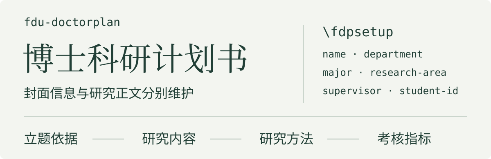

# fdu-doctorplan

<p align="center">
  
</p>

fdu-doctorplan 为复旦大学博士科研计划书提供封面和正文样式。封面字段通过 `\fdpsetup` 集中设置，研究正文按章节分别维护，通用模板可以独立编译。

[快速开始](#快速开始) · [填写封面](#填写封面) · [编辑正文](#编辑正文) · [维护与许可](#维护与许可)

## 快速开始

环境需要支持中文的 TeX 发行版，以及 XeLaTeX 和 `latexmk`。通用模板显式选择发行版随附的 Fandol 中文字体。

在 macOS 或 Linux 的终端执行：

```sh
git clone https://github.com/xkwxdyy/fdu-doctorplan.git
cd fdu-doctorplan/templates
TEXINPUTS="..:" latexmk -xelatex -outdir=../build main.tex
```

结果位于项目根目录的 `build/main.pdf`。编译从 `templates/` 运行，`TEXINPUTS` 将上级目录中的文档类加入搜索路径，末尾冒号保留 TeX 默认路径。

使用编辑器时，应将工作目录设为 `templates/`，并将项目根目录加入 TeX 搜索路径。通用入口为 [templates/main.tex](templates/main.tex)。

## 填写封面

在模板导言区设置字段：

```tex
\fdpsetup{
  info = {
    name = {待填写},
    department = {待填写},
    major = {待填写},
    research-area = {待填写},
    supervisor = {待填写},
    student-id = {待填写},
    examination-method = {公开招考}
  }
}
```

| 封面内容 | 字段 |
| --- | --- |
| 学生姓名 | `name` |
| 报考院系、报考专业、研究方向 | `department`、`major`、`research-area` |
| 导师 | `supervisor` |
| 报名号 | `student-id` |
| 考试方式 | `examination-method` |
| 日期 | `year`、`month`、`day` |

考试方式接受 `公开招考`、`本科直博` 或 `硕博连读`，封面会勾选对应项目。封面日期默认采用编译日期，可通过日期字段指定。

## 编辑正文

模板通过 `\input` 组织研究正文，各文件对应的栏目如下：

| 栏目 | 文件 |
| --- | --- |
| 立题依据与主要参考文献 | [templates/body/reference.tex](templates/body/reference.tex) |
| 研究内容与拟解决的问题 | [templates/body/content.tex](templates/body/content.tex) |
| 研究方法与技术路线 | [templates/body/method.tex](templates/body/method.tex) |
| 考核指标与预期成果 | [templates/body/result.tex](templates/body/result.tex) |

模板中的姓名、院系和正文均为占位内容。正式使用时，应替换字段和各章内容，并核对院系当前的计划书要求。

## 维护与许可

文档类维护源码为 [fdu-doctorplan.cls](fdu-doctorplan.cls)，保留 `fdu-doctorplan` 类名和 `\fdpsetup` 接口。修改样式后，可使用快速开始中的通用模板重新编译并检查封面、章节及分页。

<details>
<summary>在集成仓库中维护</summary>

本项目由独立仓库 `xkwxdyy/fdu-doctorplan` 维护，`fduTeX` 通过 Git 子模块记录版本。首次维护子模块时应确认当前分支为 `main`；子项目独立提交、推送后，根仓库再更新版本记录。

公开仓库不纳入个人申请材料、参考资料和本地分享压缩包，已有本地文件继续保留。

</details>

项目附带的许可条款见 [LaTeX Project Public License](LICENSE)，历史版本记录见 [CHANGELOG.md](CHANGELOG.md)。
